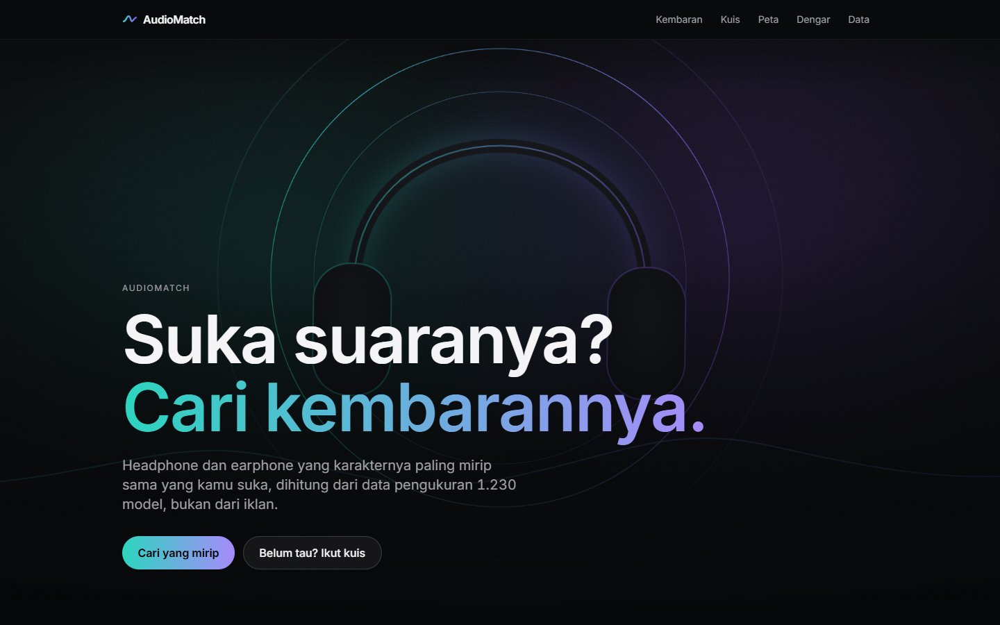

# AudioMatch

Find headphones and earphones that sound like the one you already like, based on measured frequency response instead
of marketing. The UI is in Indonesian.



## Problem

Most people pick headphones from ads, reviews that disagree with each other, or whatever a friend owns. Measurement
data exists (AutoEq alone has thousands of curves), but a raw frequency response graph means nothing to a normal
buyer. I wanted a way to say "I like how my AirPods Pro sound, what else sounds like that?" and get an answer that
is backed by data.

## Who it's for

People in Indonesia shopping for a first "serious" pair of earphones or headphones, who know what they like but not
the vocabulary (sub-bass, upper-mid, target curve).

## Live app

https://audio-chi-ten.vercel.app

## How it works

1. **Data.** `pipeline/fetch_data.py` restores a sparse clone at the full commit locked in `pipeline/rigs.json`.
   An explicit `--reselect` mode counts coverage and regenerates rig selection at that checkout revision. Coverage table:
   [docs/coverage.md](docs/coverage.md).
2. **One rig at a time.** Curves from different measurement rigs are not comparable, so a product is only compared
   with products from the same rig. The default rig for each form is the one with the most CSVs. Two more rigs were
   added by hand because they have Harman preference scores (and AirPods Pro 2 / AirPods Max).
3. **Normalize.** Each curve is interpolated to 96 log-spaced points from 20 Hz to 20 kHz and shifted so the
   300 Hz to 3 kHz average is 0 dB. Error = curve minus the rig target, clipped to +-12 dB.
4. **Similarity.** RMS distance between error curves from 20 Hz to 10 kHz, turned into a 0-100 score
   (0 dB = 100, 6 dB or more = 0). The top 10 neighbours per product are precomputed.
5. **Map and groups.** PCA (2 components) for the map, k-means for groups with k chosen by silhouette from 3 to 8.
   Group names come from rules on the centroid bands, written in [docs/method.md](docs/method.md).
6. **Quiz.** Five questions shift two numbers: a bass shelf below 150 Hz (-2 to +8 dB) and a treble tilt above 3 kHz
   (-3 to +2 dB). Products are ranked by distance to that taste curve.
7. **Listen to the difference.** A small procedural loop (kick, snare, hats, bass, pad) made with the Web Audio API
   goes through 10 peaking filters at octave centres. Gains are the B minus A curve difference, clamped to +-12 dB,
   with a heuristic preamp adjustment. This does not guarantee equal perceived loudness.

Everything runs in the browser from static JSON. No backend, no API keys, no analytics.

```bash
npm ci
npm run dev          # http://localhost:4171
npm test             # Vitest
npm run build

python -m pip install -r pipeline/requirements.txt
npm run data:fetch   # restore the locked source revision
npm run data         # rebuild public/data
npm run test:pipeline
npm run media        # hero video from media-src/hero.mp4
```

## Data and licenses

Measurements from [AutoEq](https://github.com/jaakkopasanen/AutoEq) (MIT) and the people who measured them:
Super Review, Rtings, HypetheSonics and oratory1990. Details and what was and was not checked:
[DATA_LICENSES.md](DATA_LICENSES.md).

## Evaluation

Numbers from the last pipeline run ([docs/pipeline-report.md](docs/pipeline-report.md)):

| Rig | Form | Models | PCA PC1 + PC2 | k | Silhouette |
|---|---|---:|---|---:|---:|
| Super Review, 711 | in-ear | 488 | 51.2% + 15.5% | 3 | 0.226 |
| Rtings, HMS II.3 | over-ear | 381 | 43.8% + 15.5% | 3 | 0.144 |
| HypetheSonics, GRAS RA0045 | in-ear | 127 | 50.8% + 18.5% | 3 | 0.203 |
| oratory1990, GRAS 45BC-10 | over-ear | 234 | 54.1% + 11.8% | 3 | 0.193 |

1,510 measurements, 1,230 model-rig pairs and 1,140 distinct normalized base names across rigs. These are not 1,230 verified unique physical products; see [catalog definitions](docs/catalog.md). Silhouette is low everywhere: headphone tuning is a spectrum, not neat
boxes, so the group names are a rough guide.

The stage-two audit evaluates the full frozen export with random and six-band baselines, clipping/alignment/weight ablations, PCA neighborhood preservation, variant sensitivity and all 512 quiz answer combinations. See the [evaluation report](docs/evaluation/report.md), [protocol](docs/evaluation-protocol.md) and [reproduction commands](docs/stage-two-validation.md).

The historical “14 of 23” hand-labeled check has no per-product citations. It is retained as a legacy exploratory artifact, not evidence of preference accuracy. No human validation has been completed; the [study protocol](docs/human-evaluation-protocol.md) separates usability from auditory preference evaluation.

## Limitations

- Similarity is only as good as the measurement. Fit, ear shape and unit variation are not in the data.
- Cross-rig comparison is not possible on purpose, so a model measured on two rigs shows up twice.
- The quiz weights are design assumptions, not research.
- "Dengar Bedanya" is a rough simulation that is still coloured by whatever headphone you are wearing.
- No prices. The feature exists but stays hidden until prices with a checkable source are added.
- Open earbuds are left out: the biggest earbud rig only has 27 CSVs.

## What I learned

- Git partial clone (`--filter=blob:none --sparse`) lets you inspect a 4 GB repo in seconds and fetch only the files
  you need. `git ls-tree` was enough to count coverage without downloading any data.
- Checking the real data early changed the plan: crinacle results in AutoEq have no CSV, and the rig name for most
  sources is not in the folder name but in `name_index.tsv`.
- A few measurements with a -30 dB roll-off at 20 Hz created their own k-means cluster. Clipping the error to +-12 dB
  before PCA and k-means fixed that.
- One measurement can be published under two names (Sennheiser HD 650 and HD 6XX have distance 0), so a test that
  expected every distance to be positive was wrong.
- Silhouette picked k=3 on every rig. Honest low numbers are more useful than forcing more groups.

## Credits

- Measurement data: AutoEq by Jaakko Pasanen, and Super Review, Rtings, HypetheSonics, oratory1990.
- Hero video (when added): made with an image-to-video model, then edited with `scripts/make_hero.py`.
- Built by Steven Gerald Cahyadi ([SevenZ27](https://github.com/SevenZ27)).

## Stage-one reliability checks

The quiz distinguishes in-ear and over-ear only; it does not filter wired/wireless connectivity. Malformed product URLs use the not-found view. Core data and curve panels have loading/error/retry behavior, with a 12-second request timeout and failed-request cache eviction.

Run `python scripts/refresh_catalog.py` to validate catalog identities and refresh metadata counts from the existing export without changing curves or rankings. Run `npm ci`, `npm run build`, `npm test`, `npm run test:pipeline`, and `npm run test:e2e` before releasing. Browser tests use the built output on port 4171; do not run a second preview on that port.

## UX and audio reliability

Search results, quiz answers/results, map selection and comparison choices survive product-detail navigation within the mounted app. Comparison supports direct entry from search results, same-rig selection, A/B swapping, curve comparison and return to the initiating result. Reloading the page resets this in-memory state.

Audio starts only after an explicit user action. Pending starts can be cancelled; changing the pair, hiding the tab or opening a product detail stops playback. Leaving for a detail closes the AudioContext. A/B EQ transitions are smoothed and scheduled voices are cleaned up. Displayed gain values describe the target settings; native filter measurements are recorded separately.

See [UX and audio verification](docs/ux-audio-validation.md) and the [audio response report](docs/audio/report.md). These checks cover Chromium desktop and mobile emulation, not every physical device or listening preference.
