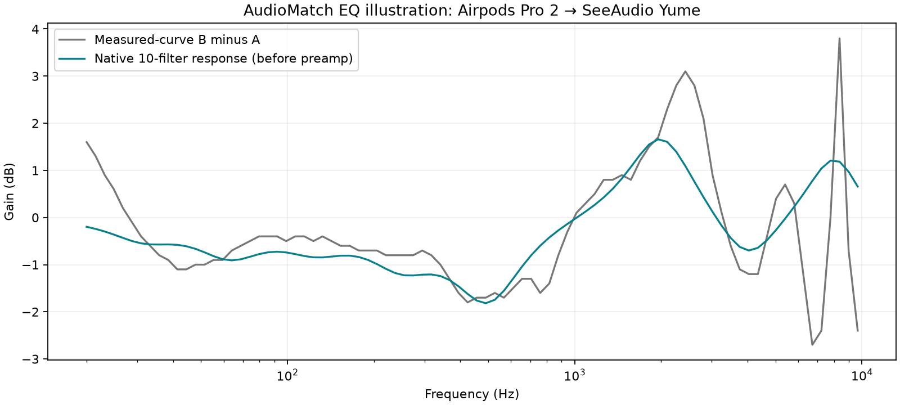

# Dengar Bedanya: native audio verification

The tested pair is `hypethesonics-inear~apple-airpods-pro-2` → `hypethesonics-inear~seeaudio-yume`. The JSON evidence includes desktop (1440 × 900) and touch-enabled mobile (375 × 812) Chromium runs. Both run the same browser engine; mobile emulation does not validate iOS audio activation, Android hardware, physical volume or acoustic output.

## Method

The browser test observes the actual AudioContext and the first ten peaking filters created by the app. After selecting B and starting playback, it waits 300 ms for the 15 ms exponential EQ transitions to settle. It calls each filter's native `getFrequencyResponse`, adds their dB responses and compares the result with exported curve B minus A over the 20 Hz–10 kHz grid. Shape RMSE removes the mean residual, separating shape approximation from constant level offset. The plotted response excludes the preamp and nonlinear compressor.

A separate OfflineAudioContext renders the observed filter parameters with a deterministic two-second, five-tone signal (63, 125, 500, 2,000 and 8,000 Hz; amplitude 0.08 per tone). It includes the app's estimated preamp and compressor settings, excludes the first 0.1 seconds, and measures sample RMS and peak. It does not render the procedural music, include the user's physical headphones or measure LUFS/perceived loudness. The master volume is excluded to compare the signal-processing paths at the same input level.

## Results for this pair

| Measurement | Desktop result |
|---|---:|
| Shape RMSE relative to curve difference | 0.952 dB |
| Estimated preamp for B | +0.3 dB |
| Probe A RMS / sample peak | 0.1281 / 0.3748 |
| Probe B RMS / sample peak | 0.1335 / 0.3906 |
| Probe B versus A RMS difference | +0.358 dB |
| A-mode maximum per-filter deviation | 0.0000 dB |

The tested signal stayed below digital full scale. This does not establish headroom for every product pair, signal or device. The nonzero response error is expected from approximating an arbitrary curve with ten octave filters; it is not a preference-accuracy score. The equal-band preamp heuristic is now described as an estimate in the UI instead of a loudness match.

## Lifecycle checks

- A and B switches update target gains with smoothing; mode A returns to a flat filter response.
- Rapid stop/restart does not leave old scheduled voices playing. Native source `ended` events return the active-voice count to zero after stop.
- Navigation to a product detail closes the active AudioContext. Returning does not autoplay.
- Pending starts can be cancelled or invalidated by navigation. A rejected resume can be retried without an unhandled rejection.
- Pair changes and hidden-tab events stop the loop. Identical A/B measurements produce zero EQ; volume zero remains selectable.

Browser automation mutes speaker output. These are signal/lifecycle tests, not a subjective listening pass. The compressor is not a brickwall peak limiter, and headphone fit, playback-device response and personal hearing remain outside this illustration.

## Reproduce

Build the app, set `PW_CHROMIUM` if using an installed Chrome and set `AUDIOMATCH_AUDIO_REPORT=1`, then run `npx playwright test e2e/audio-response.spec.ts`. Stop any preview on port 4171 first. Run `python scripts/render_audio_report.py` using the stage-two plotting environment to regenerate this report and figure. JSON files retain the numerical observations; `source-hashes.json` identifies the audited code and curve export.

References: [AudioContext.resume](https://developer.mozilla.org/en-US/docs/Web/API/AudioContext/resume), [BiquadFilterNode.getFrequencyResponse](https://developer.mozilla.org/en-US/docs/Web/API/BiquadFilterNode/getFrequencyResponse).
