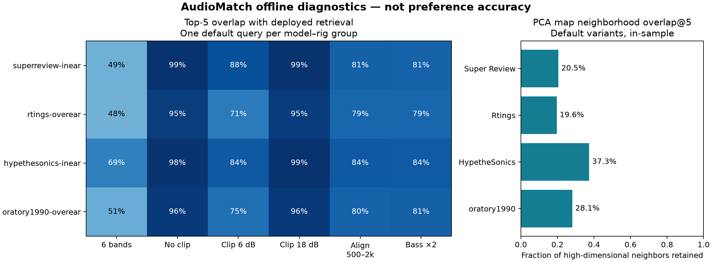

# AudioMatch: data quality and offline evaluation

Stage two evaluates the frozen 1,510-measurement catalog. No listening or user-preference labels were collected. The retrieval method remains unchanged; these experiments identify limitations and establish a reproducible baseline.

## Data quality and provenance

- All exported IDs, curve references, map memberships and neighbor constraints passed the structural gates. The catalog ledger joins every measurement to its source path and commit; physical product identity remains explicitly unresolved.
- AutoEq is locked to `7ae0f56d53074872b028649617a22bbb4232feb7`. The source manifest fingerprints 1,510 CSVs plus RANKING.md and records numerical package versions.
- Raw CSVs are read afresh on every build. Non-finite values, duplicate/non-increasing frequencies and insufficient coverage fail before export. All selected sources end at 19,955.54 Hz; interpolation holds that endpoint at 20 kHz. This is outside the 10 kHz similarity cutoff.
- Two isolated rebuilds produced identical bytes for all nine exported JSON files: **True**. Compared with the existing export, 5 neighbor rows differ; each changed rank uses an identical exported curve and the same displayed score/distance. This is reported as tie-order drift, not exact historical reproduction. The existing app data was preserved.

| Rig | Measurements | Missing preference score | Curves with clipping | Duplicate quantized-curve groups |
|---|---:|---:|---:|---:|
| superreview-inear | 714 | 714 | 24 | 2 |
| rtings-overear | 383 | 383 | 116 | 0 |
| hypethesonics-inear | 152 | 66 | 15 | 0 |
| oratory1990-overear | 261 | 54 | 51 | 1 |

Missing preference scores are structural source coverage, not zeros. Identical exported curves are review candidates, not proof of identical physical products. No records were deleted or merged.

## Retrieval baselines and sensitivity

The table uses one default query per model–rig group to avoid overweighting heavily measured models. Candidates still include all variants and exclude the query group. Values are mean top-5 base-group overlap with the saved deployed recommendations. Random ranks are uniform over candidate groups; the first variant breaks within-group ties. All-measurement aggregates, ordered agreement, unclipped RMS and per-query rows are also saved.

| Rig | Recomputed export | Random | Six bands | No clipping | Clip 6 | Clip 18 | Align 500–2k | Bass ×2 |
|---|---:|---:|---:|---:|---:|---:|---:|---:|
| superreview-inear | 98.8% | 1.1% | 48.9% | 98.7% | 87.8% | 98.7% | 81.1% | 80.7% |
| rtings-overear | 99.3% | 1.5% | 48.3% | 94.6% | 70.9% | 95.1% | 79.1% | 79.0% |
| hypethesonics-inear | 99.2% | 3.5% | 68.8% | 97.8% | 84.3% | 98.6% | 84.1% | 83.8% |
| oratory1990-overear | 99.0% | 2.6% | 50.7% | 96.0% | 75.0% | 96.1% | 80.3% | 81.1% |

Agreement measures stability, not correctness. Six-band retrieval is a simpler baseline; it is not ground truth. Unclipped RMS is another internal geometric diagnostic and favors methods designed to minimize it. No method was chosen as a winner from these numbers.

Recomputing from 0.1 dB exported curves changes some close ranks. The largest saved-distance discrepancy is 0.0195 dB, within the conservative 0.205 dB quantization-plus-rounding bound. Stable sorting uses source order for exact numerical ties. Floating-point near-ties can still vary across numerical environments, as the historical rebuild comparison demonstrates.

## PCA and measurement variants

| Rig | Map overlap@5 | Trustworthiness@5 | Variant-to-default overlap@5 | Non-default measurements |
|---|---:|---:|---:|---:|
| superreview-inear | 20.5% | 0.868 | 38.8% | 226 |
| rtings-overear | 19.6% | 0.858 | 0.0% | 2 |
| hypethesonics-inear | 37.3% | 0.901 | 38.4% | 25 |
| oratory1990-overear | 28.1% | 0.898 | 33.3% | 27 |

Trustworthiness penalizes false local neighbors by their high-dimensional rank; overlap asks whether the exact five neighbors were preserved. A relatively high trustworthiness does not imply exact neighbor retention. The map is an exploratory summary, not the retrieval ranking. Its UI claim has been corrected accordingly.

Variant sensitivity is substantial. Preserve variant labels and make the default-selection rule visible; do not present a default measurement as universal product behavior. Rtings has only two non-default measurements, so its 0% overlap must not be generalized.

## Exhaustive quiz diagnostics

The actual TypeScript quiz and ranking functions were run on all 512 answer combinations, 256 per form. All returned five eligible, distinct default models in the selected rig. Each form has 146 distinct bass/treble profiles. These combinations are synthetic and uniformly enumerated; they do not estimate user behavior.

| Rig | Unique ranked lists | Models exposed / eligible | Neutral-profile overlap@5 | +0.5 dB bass overlap@5 |
|---|---:|---:|---:|---:|
| superreview-inear | 133 | 51 / 488 | 24.3% | 70.0% |
| rtings-overear | 98 | 27 / 381 | 58.4% | 85.5% |

The quiz explores a narrow two-parameter taste family, so limited catalog exposure is expected. Exposure is not a fairness or satisfaction metric. The bass perturbation is clamped to the existing range. Future work should test whether users understand these controls before adding or fitting more weights.

## Decisions and portfolio claims

Keep rig isolation, retain the current retrieval parameters, expose uncertainty in the map, and preserve source/variant provenance. The legacy “14 of 23” label check is not validated ground truth and is no longer presented as evidence of recommendation accuracy.

Supported claim: built and audited a reproducible content-based retrieval pipeline over 1,510 measurements, evaluated baseline and parameter sensitivity per rig, and quantified PCA neighborhood preservation and quiz coverage. This describes project work; personal ownership should match the contribution history.

Unsupported claims: recommendation accuracy percentages, demonstrated human preference prediction, improved purchasing outcomes, or equivalence to the physical headphone sound. The next evidence gap is human evaluation, using the prepared [study protocol](../human-evaluation-protocol.md).

## Reproduction and evidence

See [the pre-run protocol](../evaluation-protocol.md), [reproduction commands](../stage-two-validation.md), `metrics.json`, `quiz.json`, `per-query.csv`, `catalog-ledger.json`, `source-manifest.json` and `rebuild.json` in this directory.

References: [AutoEq](https://github.com/jaakkopasanen/AutoEq); [scikit-learn trustworthiness definition](https://scikit-learn.org/stable/modules/generated/sklearn.manifold.trustworthiness.html).
