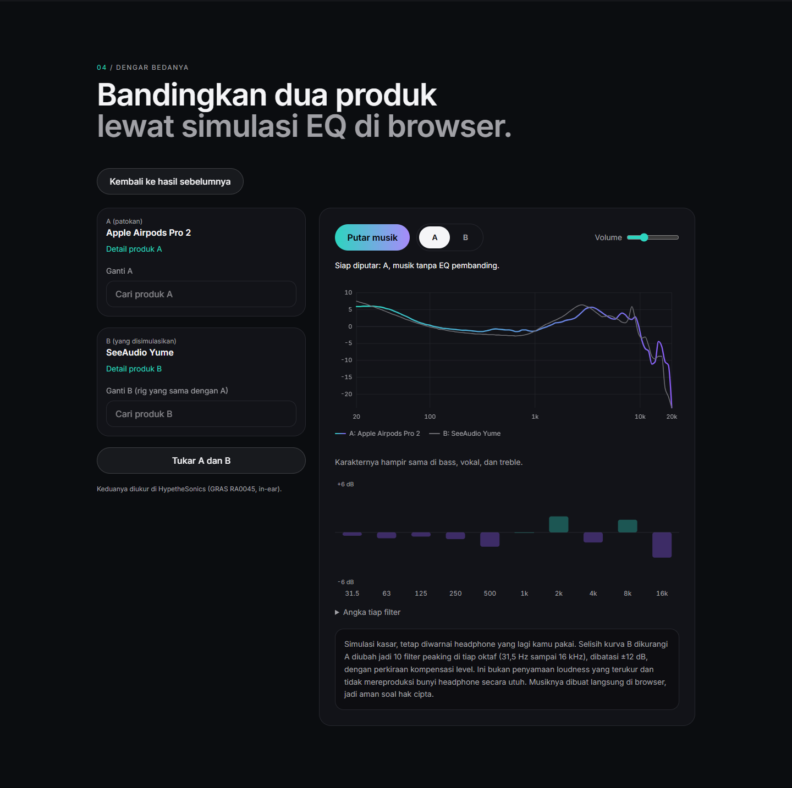

# AudioMatch: from measurement data to an interactive comparison app

[Live app](https://audio-chi-ten.vercel.app) · [Source code](https://github.com/SevenZ27/audio)

AudioMatch is a React and TypeScript application for exploring headphone and earphone frequency-response measurements. It connects a reproducible Python data pipeline with product search, same-rig recommendations, a taste quiz, a PCA map and a browser-based A/B EQ illustration. The interface is in Indonesian.

## The design problem

The project starts with a practical question: how can someone who already likes one product explore alternatives using measurement data? A raw curve alone does not explain the comparison workflow. AudioMatch turns the available measurements into searchable candidates and visible differences, while keeping the limits of those comparisons explicit.

This is the design rationale, not a finding from user interviews. A formative study was prepared but not conducted; user testing was excluded from this release at the project owner's request.

## Data and method

The catalog contains **1,510 measurements, 1,230 model–rig pairs and 1,140 distinct normalized base names**. These are different units. A model measured on two rigs appears in both groups; base names have not been verified as globally unique physical products.

The source is a locked AutoEq revision. Every selected CSV has a source path and SHA-256 fingerprint. The pipeline validates finite values, increasing frequencies and usable coverage before interpolation. It aligns each curve over 300 Hz–3 kHz and exports 96 logarithmically spaced frequencies. Recommendations compare clipped target-relative curves using RMS distance up to 10 kHz, within one measurement rig only.

Two isolated rebuilds produced identical bytes across all nine exported JSON files in the recorded numerical environment. Comparison with the earlier export found five neighbor rows with tie-order differences among identical exported curves; this is documented rather than described as exact historical reproduction. See the [evaluation report](evaluation/report.md) and [reproduction instructions](stage-two-validation.md).

## Application engineering

The Python pipeline runs offline and produces static JSON. React loads the catalog and rig-specific curves in the browser. Search and product detail share catalog identities; recommendations remain within the selected rig. There is no production database, authentication service or server-side recommendation API.

The search-to-comparison flow preserves the selected product, quiz answers, map state and previous results while opening product detail. Return navigation restores the initiating section and focus where possible. Reloading resets this in-memory state. Failed data requests have a visible retry path, and malformed product links lead to a recoverable not-found view.

Web Audio generates the music locally and applies ten peaking filters to illustrate the measured B-minus-A difference. The player handles pending startup, cancellation, pair changes, tab visibility and cleanup of scheduled audio sources. Mode A plays without comparison EQ; mode B applies the difference. The preamp is a level heuristic, not measured loudness matching or a validated reproduction of a physical headphone.

## Evaluation and decisions

The offline evaluation compares retrieval against random and six-band baselines, then changes clipping, alignment and bass weighting to measure sensitivity. Agreement with the current method measures stability, not recommendation correctness.

PCA preserves only **19.6%–37.3% of the exact top-five neighbors** across the four rigs, even though trustworthiness is higher. This finding informed the UI explanation: the map is an exploratory summary, not a ranking. Measurement variants also change nearest neighbors, so variant identities and rig boundaries remain visible.

All **512 quiz answer combinations** were enumerated using the actual TypeScript functions. Every combination returned five eligible, distinct default models. The quiz exposed 51 of 488 in-ear models and 27 of 381 over-ear models, reflecting its narrow bass/treble preference family. These are synthetic coverage diagnostics, not observed user behavior or preference accuracy.

The final local verification on 20 October 2026 passed **19 unit tests, 29 Python pipeline tests and 47 browser cases**. One additional desktop case is intentionally skipped because it tests mobile touch behavior. Browser coverage includes desktop and touch-enabled mobile emulation, not certification on physical phones or Safari. Comparison screenshots were visually inspected at both sizes.

Rendered PCM probes confirmed that UI A/B switching changes the audio graph for two pairs. A separate offline render used the app's actual music instruments with identical seeded source material. The project owner subsequently confirmed that comparison playback worked in their own session. That confirmation closes their playback report; it is not a controlled listening study and does not establish a root cause for the earlier observation.

## What this project demonstrates

For application development, the evidence is the integration of typed catalog data, interactive charts, stateful navigation, asynchronous recovery and Web Audio lifecycle behavior, backed by automated tests.

For data work, the evidence is provenance, explicit catalog grain, deterministic rebuilding, geometric retrieval, dimensionality-reduction diagnostics, sensitivity analysis and exhaustive quiz coverage. The evaluation reports limitations instead of inventing an accuracy percentage.

Human relevance and usability remain unvalidated. No claim is made about improved purchasing outcomes, predicted personal preference or equivalence to hearing the actual products. The [user-testing kit](user-testing/README.md) is retained for future use, with no participant results.

## Repository guide

- `src/`: React interface, retrieval utilities and audio engine.
- `pipeline/`: locked-source fetching, validation, export and offline evaluation.
- `public/data/`: the static catalog and curves consumed by the application.
- `e2e/`: browser journeys, recovery behavior and native audio checks.
- `docs/evaluation/`: metrics, per-query diagnostics, source fingerprints and rebuild evidence.
- [Release checks](release-2026-10-20.md): final verification scope and publication record.
